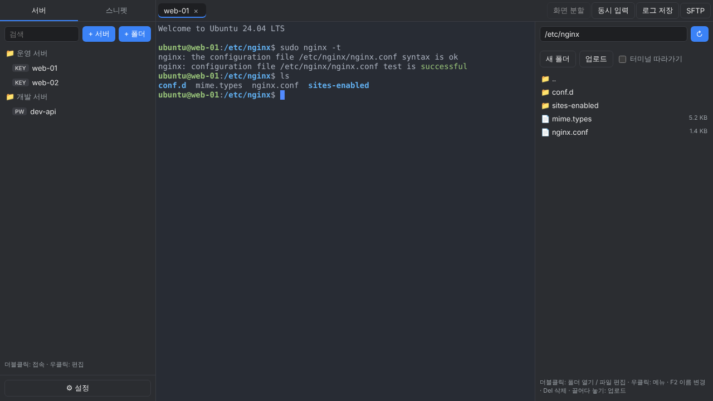

# Dari (다리)

Windows · macOS용 SSH / SFTP 데스크톱 클라이언트

내 PC와 서버를 잇는 **다리**라는 뜻입니다.

터미널과 파일 탐색기를 한 화면에서 쓰고, 서버 파일을 **vi 없이 내 PC의 에디터로 바로 고칠 수 있는** 것을 목표로 만들었습니다.



## 주요 기능

### 접속

- 서버 목록을 폴더로 정리하고 검색
- 비밀번호 / 키 파일(.pem, OpenSSH) / 키 패스프레이즈 / OTP 인증
  - Ubuntu처럼 keyboard-interactive 방식만 허용하는 서버도 지원
  - 비밀번호를 저장하지 않으면 접속할 때마다 입력 창이 뜸
- 처음 접속하는 서버의 호스트 키(지문) 확인, 키가 바뀌면 경고
- 서버별 문자 인코딩: UTF-8 / **EUC-KR(CP949)** — 오래된 국내 서버의 한글도 깨지지 않음

### 터미널

- 탭, 좌우 화면 분할
- **새 탭(+ / `Ctrl+Shift+T`)**: 서버를 검색해서 Enter로 바로 접속
- **탭 복제**: 같은 서버로 새 탭을 하나 더 열어 자동 접속 (탭 우클릭 / `Ctrl+Shift+D`)
- 탭 우클릭 메뉴: 복제, 재접속, 이름 변경, 다른 탭 모두 닫기 · 가운데 버튼 클릭으로 닫기
- 연결이 끊기면 자동 재접속 (최대 3회, 직접 `exit`한 경우는 제외)
- **동시 입력**: 체크한 여러 서버에 같은 키 입력을 한 번에 보냄
- **스니펫**: 자주 쓰는 명령을 저장해 두고 더블클릭으로 실행
- 세션 로그 저장 (색상 코드를 빼고 읽기 쉬운 텍스트로)

### SFTP

- 터미널 옆 파일 탐색기 (같은 SSH 연결을 사용해 다시 로그인하지 않음)
- 드래그앤드롭 업로드, 다운로드, 진행률 표시
- 새 폴더, 이름 변경(F2), 삭제(Del, 폴더는 안의 내용까지), 권한 변경(chmod)
- **원격 파일 편집**: 파일을 더블클릭하면 VS Code 등 로컬 에디터로 열리고, **저장할 때마다 서버에 자동 업로드**
- **터미널 따라가기**: 터미널에서 `cd` 하면 파일 탐색기도 같은 폴더로 이동 (bash / zsh)

### 설정 (⚙ 버튼 또는 `Ctrl + ,`, 제목줄을 끌어서 이동)

- 앱 테마: 다크 / 라이트 / 시스템 설정 따르기
- 터미널 색 테마 17종 (One Dark, Dracula, Tokyo Night, Catppuccin, Gruvbox, Nord, GitHub Light 등)
- 글꼴, 글자 크기, 줄 간격, 커서 모양, 스크롤 기록 줄 수
- 접속 기본값: 새 서버에 미리 채울 사용자·포트·키 파일·인코딩, 연결 유지 신호, 접속 대기 시간
- SFTP: 숨김 파일 표시, 기본 다운로드 폴더(묻지 않고 바로 저장), 업로드 시 덮어쓰기 확인
- 원격 파일 편집에 쓸 에디터 지정

### 단축키

| 키 | 동작 |
|---|---|
| 드래그로 선택 후 `Ctrl + C` | 복사 |
| 선택 없이 `Ctrl + C` | 실행 중인 명령 중단 (^C) |
| `Ctrl + V` | 붙여넣기 |
| `Ctrl + =` / `Ctrl + -` / `Ctrl + 0` | 터미널 글자 크게 / 작게 / 기본값 |
| `Ctrl + Shift + T` | 새 탭 (서버 검색 후 접속) |
| `Ctrl + Shift + D` | 지금 탭 복제 (같은 서버로 새로 접속) |
| `Ctrl + Shift + W` | 지금 탭 닫기 |
| `Ctrl + Tab` / `Ctrl + Shift + Tab` | 다음 / 이전 탭 |
| `Ctrl + ,` | 설정 열기 |
| `F2` / `Del` (SFTP 패널) | 이름 변경 / 삭제 |

macOS에서는 `Ctrl` 대신 `Cmd`를 사용합니다.

---

## 개발 환경 준비

### 공통

- [Node.js](https://nodejs.org/) 22 이상
- Git

### Windows 추가 준비

별도로 설치할 빌드 도구는 없습니다. (네이티브 모듈인 better-sqlite3가 Windows·macOS용 바이너리를 미리 포함하고 있어 컴파일이 필요 없습니다)

PowerShell에서 `npm` 실행이 막히면(“스크립트를 실행할 수 없으므로…”) 아래를 한 번 실행합니다.

```powershell
Set-ExecutionPolicy -Scope CurrentUser -ExecutionPolicy RemoteSigned
```

### macOS 추가 준비

없습니다. macOS 13 (Ventura) 이상에서 실행됩니다.

## 개발 모드로 실행

```bash
git clone <저장소 주소>
cd dari
npm install
npm run dev
```

---

## 실행 파일 만들기

### Windows (.exe)

**Windows PC에서** 실행합니다.

```powershell
npm run dist:win
```

`dist` 폴더에 두 가지가 만들어집니다.

| 파일 | 설명 |
|---|---|
| `Dari Setup 0.1.0.exe` | 설치 파일. 설치 경로를 고를 수 있고 시작 메뉴에 등록됨 |
| `Dari-0.1.0-portable.exe` | 설치 없이 더블클릭으로 바로 실행 |

### macOS (.dmg)

**Mac에서** 실행합니다. (Windows에서는 Mac용을 만들 수 없습니다)

```bash
npm run dist:mac
```

`dist` 폴더에 Apple Silicon(M1 이상)용 `arm64` dmg와 Intel Mac용 `x64` dmg가 만들어집니다.

### 아이콘 바꾸기

`resources/` 폴더에 아이콘을 넣고 다시 빌드하면 적용됩니다.

- Windows: `resources/icon.ico` (256×256 이상)
- macOS: `resources/icon.icns`

### 빌드할 때 자주 나는 문제

| 증상 | 해결 |
|---|---|
| `Electron uninstall` 또는 Electron 다운로드 실패 | `npm install`·`npm run dev` 때 자동으로 내려받습니다. 회사망에서 막히면 `ELECTRON_MIRROR`를 지정하고 `node scripts/ensure-electron.mjs` 실행 (안내 문구가 출력됨) |
| 빌드 중 `symbolic link` / 권한 오류 | 관리자 권한 PowerShell에서 다시 실행하거나, Windows 설정 → 개발자용 → **개발자 모드** 켜기 |
| 처음 빌드가 오래 걸림 | electron-builder가 NSIS 등 도구를 처음 한 번 내려받는 중 (정상) |

---

## 설치해서 쓸 때 주의할 점

### 처음 실행할 때 보안 경고가 뜹니다

이 앱은 코드 서명을 하지 않았기 때문에 OS가 "확인되지 않은 프로그램"으로 경고합니다. 처음 한 번만 허용하면 그 뒤로는 그냥 실행됩니다.

**Windows**

"Windows의 PC 보호" 창이 뜨면 **추가 정보 → 실행**을 누릅니다.
회사 PC는 보안 정책 때문에 아예 실행이 막힐 수 있습니다.

**macOS**

1. dmg를 열고 Dari를 **Applications 폴더로 드래그**합니다.
2. 터미널에서 아래 명령을 **한 번** 실행합니다.
   ```bash
   xattr -dr com.apple.quarantine /Applications/Dari.app
   ```
   또는 앱을 한 번 실행해 경고를 띄운 뒤 **시스템 설정 → 개인정보 보호 및 보안 → "그래도 열기"**를 누릅니다.
   (macOS 15 Sequoia부터는 예전의 "우클릭 → 열기" 방법이 동작하지 않습니다)

> 직접 Mac에서 빌드해서 쓰는 경우에는 이 과정이 필요 없습니다.

### 데이터 저장 위치

등록한 서버, 스니펫, 설정은 **각자의 PC에만** 저장되며 어디로도 전송되지 않습니다.

| OS | 위치 |
|---|---|
| Windows | `%APPDATA%\dari\dari.db` |
| macOS | `~/Library/Application Support/dari/dari.db` |

- 앱을 새 버전으로 다시 설치하거나 삭제했다 설치해도 데이터는 유지됩니다.
- 완전히 초기화하려면 위 폴더를 지웁니다.

### 비밀번호 보관 방식

- 저장한 비밀번호와 키 패스프레이즈는 OS의 암호화 저장소로 암호화해 보관합니다. (Windows: DPAPI / macOS: 키체인)
- 그래서 **DB 파일을 다른 PC로 복사해도 비밀번호는 풀리지 않습니다.** 다른 PC에서는 비밀번호를 다시 입력해야 합니다.
- 키 파일(.pem) 자체는 앱 안에 복사하지 않고 **경로만 저장**합니다. 키 파일을 옮기거나 지우면 접속이 안 됩니다.

### 호스트 키 경고

- 처음 접속하는 서버는 지문(SHA256)을 보여 주고 확인을 받습니다.
- 이미 접속했던 서버의 키가 바뀌면 **경고**가 뜹니다. 서버를 재설치했거나 IP가 다른 서버로 바뀐 경우가 아니라면 **접속하지 마세요.** (중간자 공격 가능성)

### 원격 파일 편집

- 편집 중인 파일은 임시 폴더에 내려받아 열리며, **저장할 때마다 서버 파일을 덮어씁니다.**
- 같은 파일을 서버에서 다른 사람이 동시에 고치고 있다면 그 내용이 덮어써질 수 있습니다.
- 권한이 필요한 파일(`/etc/nginx/nginx.conf` 등)은 접속 계정에 쓰기 권한이 있어야 업로드됩니다. `sudo`가 필요한 파일은 업로드가 실패합니다.
- 탭을 닫으면 자동 업로드도 멈춥니다.

### EUC-KR(CP949) 서버

- 터미널 입출력(화면에 보이는 한글, 입력하는 한글, 세션 로그)은 서버 인코딩에 맞춰 변환됩니다.
- **SFTP 파일 이름은 UTF-8만 지원합니다.** EUC-KR 서버에 한글 이름 파일이 있으면 SFTP 패널에서는 이름이 깨져 보일 수 있습니다. (파일 내용 전송은 상관없음)
- 원격 파일 편집은 파일을 바이트 그대로 주고받으므로, 에디터에서 인코딩을 EUC-KR로 열어야 한글이 보입니다.

### 터미널 따라가기

- 처음 켤 때 셸에 현재 경로를 알려주는 설정 한 줄을 자동으로 입력하며, 그 줄이 터미널에 보입니다.
- bash, zsh에서만 동작합니다.

### 동시 입력

- 켜져 있는 동안 키 입력이 **체크된 모든 탭**으로 전송됩니다. 위험한 명령(`rm`, `reboot` 등)을 칠 때는 대상 탭을 꼭 확인하세요.

### 자동 업데이트 없음

새 버전이 나오면 exe / dmg를 다시 받아 설치해야 합니다. 데이터는 유지됩니다.

---

## 프로젝트 구조

```
scripts/
  ensure-electron.mjs  Electron 실행 파일이 없으면 내려받기 (설치 직후·dev 실행 전 자동)
src/
  main/          Electron 메인 프로세스 (Node.js)
    index.ts       창 생성, 메뉴, 보안 설정
    ipc.ts         화면 → 메인 요청 처리 (유일한 진입점)
    db.ts          SQLite 스키마·마이그레이션, 비밀번호 암호화 저장, 설정
    ssh.ts         SSH 연결, 인증, 호스트 키 검증, 끊김 감지, 인코딩 변환
    sftp.ts        SFTP 목록·전송·파일 관리·원격 파일 편집
    sessions.ts    열린 터미널 관리, 세션 로그
    prompt.ts      접속 중 비밀번호·OTP 입력 요청
  preload/       contextBridge로 window.api 노출
  renderer/      React 화면
    src/components/  HostTree, TerminalView, SftpPanel, SnippetPanel, SettingsDialog …
    src/themes.ts    터미널 색 테마
  shared/        메인·화면 공용 타입
```

### 기술 스택

| 영역 | 사용 |
|---|---|
| 앱 | Electron 45, electron-vite, electron-builder |
| 화면 | React, TypeScript, xterm.js |
| SSH / SFTP | ssh2 |
| 인코딩 변환 | iconv-lite |
| 로컬 저장소 | better-sqlite3 |

### 보안 설정

- 화면(renderer)에는 Node.js API를 주지 않습니다. (`contextIsolation`, `sandbox`, `nodeIntegration: false`)
- 화면과 메인 프로세스는 `preload`에서 노출한 함수로만 통신합니다.
- 외부 링크는 기본 브라우저로 열고, 앱 안에서 다른 페이지로 이동하지 않습니다.

## 앞으로 할 일

- [ ] 점프 호스트(bastion) 경유 접속, SSH 포트 포워딩
- [ ] 앱을 다시 켜면 열려 있던 탭 복원
- [ ] PuTTY / MobaXterm / `~/.ssh/config` 서버 목록 가져오기
- [ ] 서버 상태 표시줄 (CPU · 메모리 · 디스크)
- [ ] 자동 업데이트

## 라이선스

[MIT](LICENSE)
